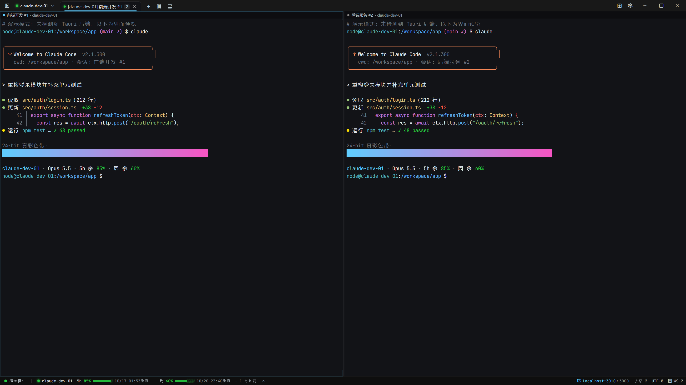
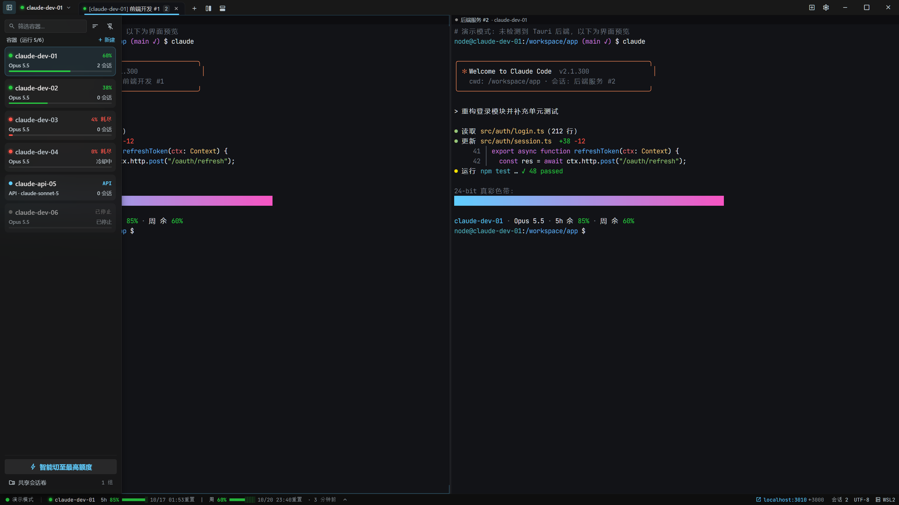
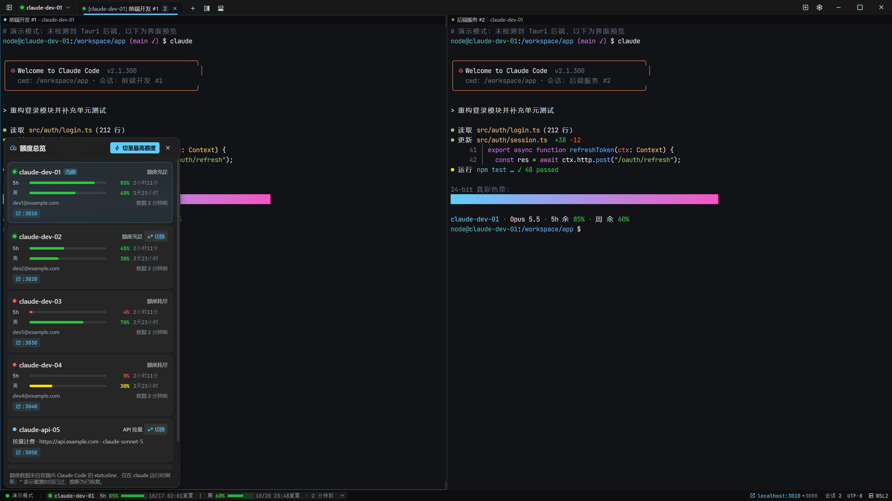

# tht-docker-claude · Claude 多容器终端管理器

以**终端为绝对核心**（实测占屏 92.8%–94.8%）的 Windows 桌面软件：在多个 Docker 容器中运行 Claude Code，
底部状态栏实时显示每个容器的 5 小时 / 周额度，额度耗尽时一键切换到其他容器并通过 `--resume` 继承对话。
每个容器可单独开启代理（mihomo + TUN，DNS 防泄露，代理不可用时断网而非回退直连）。

## 项目截图

以下截图来自演示模式，账号、额度、项目与终端输出均为示例数据。

**多标签与分屏终端**



<details>
<summary>查看容器管理与额度总览截图</summary>

**容器列表与运行状态**



**5 小时与周额度总览**



</details>

## 目录

```
docker/                     容器侧（交付物 2、3、4 的脚本部分）
  Dockerfile                真彩 + tmux + statusline 采集 + 端口守护 + mihomo 代理
  tmux.conf                 前缀禁用、状态栏关闭、RGB 透传
  docker-compose.yml        命名卷 / 共享卷 / 127.0.0.1 端口映射
  rootfs/opt/tdc/           entrypoint(root→node) / statusline.mjs / portwatch / tdc-ctl / tdc-session / tdc-lib
                            tdc-proxy / proxy-guard / tdc-proxy-lib（代理控制、兜底规则、状态分类）
  scripts/                  tdc-quota.sh、tdc-switch.sh（无桌面端也能查额度、切换）
  tests/                    node --test 用例与 fixture
src-tauri/                  Rust 后端（bollard、会话管理、额度轮询、热切换、代理配置生成）
src/                        React 前端（标题栏/Tab、分屏终端、状态栏、侧栏、额度浮层、8 个弹框）
docs/                       操作指南、功能说明、排障记录与项目截图
```

## 快速开始

Windows x64 用户可直接从 [1.0 Release](https://github.com/asia001-ya/cc-docker/releases/tag/v1.0) 下载安装包或独立运行文件。运行前安装并启动 Docker Desktop（WSL2 / Linux 容器模式）；首次启动按引导构建容器镜像。更新内容见 [1.0 发布说明](docs/releases/1.0.md)。

从源码运行：

```bash
# 1. 安装 Docker Desktop（WSL2 后端），运行桌面端
npm ci
npm run tauri dev
# 2. 首次启动若没有默认镜像，启动页会引导「构建镜像」（构建上下文内置于应用），完成后才能新建容器
#    也可手动构建：cd docker && docker build -t tdc/claude-dev:latest .
# 仅预览界面（浏览器演示模式，无需 Docker）
npm run dev   # http://localhost:5420
```

详见 [docs/04-operations-guide.md](docs/04-operations-guide.md)。

生成的计划、实现类 Markdown 文件可点击终端右上角的「输出内容」独立阅读，支持搜索、复制和保留阅读位置。见 [输出内容阅读面板](docs/09-output-reader.md)。

容器右键菜单中的「Git 凭据」可按域名复用宿主机 HTTPS 登录，并选择同步提交姓名和邮箱。见 [使用宿主机 Git 凭据](docs/11-git-sharing.md)。

## 测试

```bash
npm run test:docker && npm test && npm run typecheck
npm run test:privacy
npm run test:outputs
cargo test --manifest-path src-tauri/Cargo.toml
```

## 重要说明

- 仓库只收录源码、公开文档和合成测试数据。供应商配置、代理节点与订阅、Git 凭据、密钥、会话记录及其备份均由 `.gitignore` 排除；只有不含凭据的 `docker/.env.example` 作为环境模板提交。演示中的示例域名和文档专用 IP 不代表真实账号或节点。
- README 引用的演示截图经隐私检查后随源码发布；其余验证截图、设计文档、原始设计导出和压缩包仅保留在本地。私有设计项目链接不随源码发布。

- 安装包只内置公开模型定价和公共程序资源；供应商、授权账号、代理节点/订阅/凭据、会话和用量均属于个人运行数据，不随安装包分发。正式构建会移除演示数据，并执行打包隐私检查，详见 [定价与分发隔离](docs/07-claude-pricing.md)。

- 额度数据只有百分比，自动采集随 Claude statusline 更新；运行中的授权容器也可在额度总览手动刷新账号用量（见 docs/03）。
- 多订阅账号轮换可能违反 Anthropic 服务条款，请自行评估。
- 镜像入口以 root 运行并降权为 node：手工 `docker exec` 请带 `-u node`。
- 代理已在本机 Docker 上端到端实测（本地 vless 服务端）；真实互联网节点与 GUI 全流程待验证，验证范围见 [容器代理说明](docs/06-proxy.md)。
