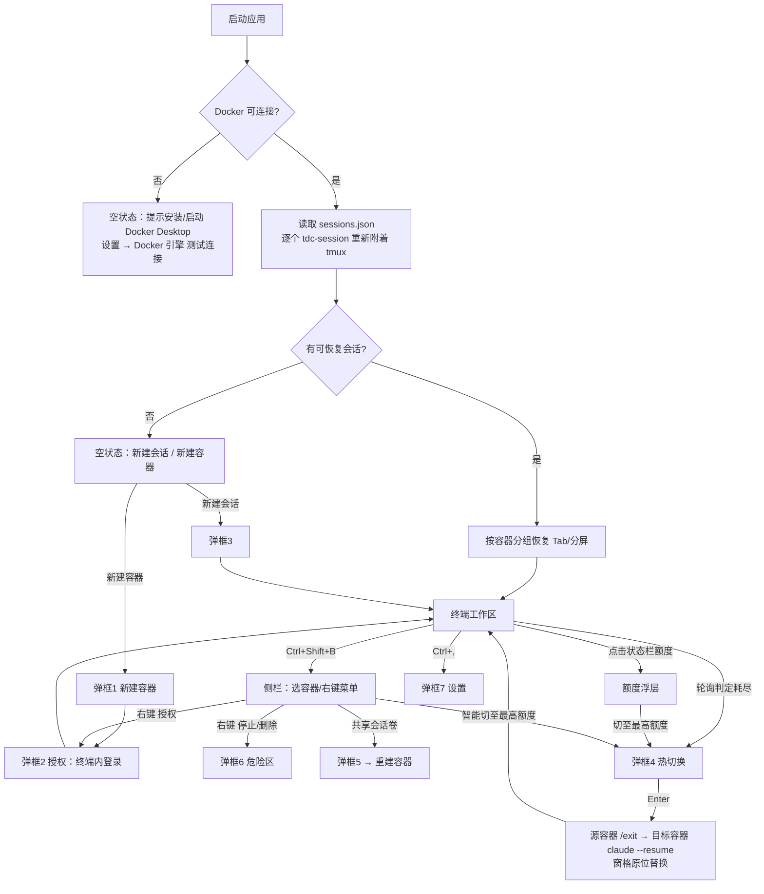

# 01 · 终端至上 UI 原型与页面流程

> 交付物 1。所有界面文案为简体中文；视觉令牌来自 Fluent Container Studio 原始设计稿，以下保留公开的实现说明。
> 实现位于 `src/components/`，浏览器演示：`npm run dev` 后访问 `http://localhost:5420`（无 Tauri 后端时自动进入演示模式）。
> 原始设计导出与实测截图仅在本地保留，不随仓库发布。

## 0. 与设计稿的差异（有意为之）

| 原始设计稿 | 本实现 | 原因 |
|---|---|---|
| 顶部 5 个导航页（主控制台/多会话终端/额度监控/端口映射/共享卷状态） | 取消导航页，功能下沉到侧栏、状态栏、浮层与弹框 | 导航页 + 288px 常驻侧栏使终端只占约 75%，违背"终端 ≥85%" |
| 标题栏 40px + 导航 40px | 标题栏与 Tab 栏合并为 **32px** 一行 | 节省 48px 垂直空间 |
| 侧栏 288px 常驻 | **260px 浮层抽屉**，默认隐藏，可"钉住"为常驻 | 默认不占用终端面积 |
| 5h 额度显示 `142,500 / 200,000 tk` | 显示**剩余百分比 + 方块进度条 + 重置时间** | Claude Code 只提供百分比（`rate_limits.*.used_percentage`），无 token 绝对值；200k 是上下文窗口而非额度 |
| `Host: unix:///var/run/docker.sock` | `Docker 12ms`（悬停显示 npipe 地址） | Windows 上 Docker Desktop 走 named pipe |
| 凭证源路径 `%USERPROFILE%\.claude\config.json` | `.credentials.json`（容器独立卷） | 设计稿路径不准确；且默认改为每容器独立账号 |
| 模型 Sonnet 3.7 / Opus 3 | 显示 statusline 上报的实时 `model.display_name` | 设计稿模型名已过时 |
| "双向热更新监听 (inotify)" | 提示 Windows 盘符目录 I/O 慢、监听不可靠，建议 WSL2 文件系统 | Windows 路径 bind mount 到 WSL2 容器时 inotify 不可靠 |
| 侧栏快捷键 Ctrl+B | 默认 **Ctrl+Shift+B**（设置中可改回） | Ctrl+B 是 Claude Code「转后台」、tmux 前缀、bash 光标左移 |

## 1. 主界面布局（1920×1080 实测终端面积 94.8%；1366×768 实测 92.8%）

```
┌──────────────────────────────────────────────────────────────────────────────────────────────────┐
│[◧]●claude-dev-01 ▾│▸[claude-dev-01] 前端开发 #1  2 ×│[claude-dev-02] 后端服务 #1 ×│ + ◫ ⬓   ▣ ⚙ │ ─ □ × │ 32px
├────────────────────────────────────────────────┬─────────────────────────────────────────────────┤  标题栏+Tab
│● 前端开发 #1 · claude-dev-01                     │○ 后端服务 #2 · claude-dev-01                     │  分屏时显示 20px 窗格条
│ node@claude-dev-01:/workspace/app (main ✓) $    │ $ npm run dev -- --host 0.0.0.0                 │
│ ╭────────────────────────────────────────╮      │   VITE v7  ready in 412 ms                      │
│ │ ✻ Welcome to Claude Code  v2.1.300     │      │   ➜  Local:   http://localhost:5173/            │
│ ╰────────────────────────────────────────╯      │                                                 │
│ > 重构登录模块并补充单元测试                     │                                                 │
│ ● 更新 src/auth/session.ts  +38 -12             ┃ ← 可拖动分隔条（双击复位 50%）                  │
│ ● 运行 npm test … ✓ 48 passed                   │                                                 │
│ ▇▇▇▇▇▇▇▇▇▇▇▇▇▇ 24-bit 真彩色带 ▇▇▇▇▇▇▇▇▇▇▇▇▇▇     │                                                 │
│                    真彩终端画布（xterm.js WebGL，≥ 85% 面积）                                       │
├──────────────────────────────────────────────────────────────────────────────────────────────────┤
│● Docker 12ms │ ●claude-dev-01 5h 85% ■■■■■■■■■░ 15:00重置 | 周 60% ■■■■■■░░░░ · 刚刚 ▴ │ ⇱localhost:3010←3000 +2端口 Opus 5.5 ctx 12% 会话 2 UTF-8 WSL2 │ 24px
└──────────────────────────────────────────────────────────────────────────────────────────────────┘
```

| 区域 | 尺寸 | 内容 / 交互 |
|---|---|---|
| 标题栏 | 32px | `◧` 侧栏开关；`●容器名 ▾` 当前容器（点击展开侧栏）；Tab（状态灯 + `[容器] 会话名` + 分屏数 + ×，中键关闭）；`+` 新建会话；`◫`/`⬓` 左右/上下分屏；`▣` 新建容器；`⚙` 设置；Windows 11 标题按钮（46×32，关闭悬停 `#E81123`）；空白处可拖动窗口 |
| 终端工作区 | 其余全部 | 每个 Tab 一棵分屏树；叶子 = 容器内 tmux 会话；聚焦窗格有 1px 强调描边；会话结束时右下角提示 |
| 状态栏 | 24px | Docker 连接与延迟 → 设置/Docker；当前容器 5h / 周 **剩余%** + 10 格方块条 + 重置时刻 + 数据新鲜度（点击打开额度浮层）；首个可访问 Web 端口（点击用系统浏览器打开）；模型、上下文占用、会话数 |

状态色（DESIGN.md）：剩余 >30% 绿 `#28CA41`；5–30% 黄 `#FCE100`；<5% 或耗尽红 `#FF5449`；停止/未知灰 `#8A8886`；API 模式蓝 `#60CDFF`。

## 2. 侧栏抽屉（Ctrl+Shift+B）

```
┌─────────────────────────────┐
│ 🔍 筛选容器…        ⇅  📌   │  ⇅ 按剩余额度排序；📌 钉住（常驻，推开终端）
│ 容器（运行 5/6）      + 新建 │
│┌───────────────────────────┐│
││● claude-dev-01        85% ││  左键：在该容器新开 claude 会话
││ Opus 5.5            2 会话 ││  右键：容器菜单
││ ████████████████████░░░░ ││
│└───────────────────────────┘│
│ ● claude-dev-03     4% 预警 │  黄灯 + 脉冲
│ ● claude-dev-04     0% 耗尽 │  红灯 + 「冷却中」
│ ● claude-api-05        API  │  蓝灯：API · claude-sonnet-5
│ ○ claude-dev-06     已停止  │  灰灯，半透明
│ ─────────────────────────── │
│ [ ⚡ 智能切至最高额度 ]      │  → 弹框 4
│ 📁 共享会话卷          1 组 │  → 弹框 5
└─────────────────────────────┘
右键菜单：新建终端会话 / 账号授权·切换 API（弹框 2）/ 启动·重启 / 停止·强制停止…（弹框 6）/ 删除容器…（弹框 6）
```

## 3. 极简挂件：额度浮层（点击状态栏额度区或 Ctrl+Shift+Q）

```
┌ 额度总览 ─────────────────────────── [⚡ 切至最高额度] × ┐
│ ● claude-dev-01  当前                       额度充足      │
│   5h ███████████████░░░  85%   2小时13分                 │
│   周 ██████████░░░░░░░░  60%   4天0小时                   │
│   dev1@example.com                      数据 刚刚         │
│   [⇱:3010] [⇱:5183]  8080̶                                 │  删除线 = 监听中但未映射/仅 127.0.0.1
│ ● claude-dev-02                      额度充足  [⇄ 切换]   │
│ ...                                                        │
│ 额度数据来自容器内 statusline，仅在 claude 运行时刷新；*=推断已重置 │
└────────────────────────────────────────────────────────────┘
```

## 4. 七个弹框

所有弹框共用 `Modal`：Acrylic 遮罩、12px 圆角、`Esc` 关闭、`Ctrl+Enter` 主操作、Tab 焦点约束；点击遮罩关闭。

### 弹框 1 · 新建 / 导入容器（1040px）

```
┌ ▣ 新建 / 导入 Claude 工作容器  DOCKER          [新建容器|导入已有]  × ┐
│┌ 基础实例配置 ─────────── 槽位 07 ┐┌ Claude 授权模式 ──────────────┐│
││ 容器名称 *          ✓命名可用    ││ (●) 独立订阅账号        推荐   ││
││ [claude-dev-07              ]   ││     独立凭证卷，创建后终端内登录││
││ 运行镜像            本地已就绪   ││ ( ) API 供应商                 ││
││ [tdc/claude-dev:latest      ]   ││     Base URL + Token，按量计费 ││
││ CPU 核数 [4]   内存 MB [8192]   ││ ⚠ 多账号轮换可能违反服务条款   ││
│└─────────────────────────────────┘└────────────────────────────────┘│
│┌ 项目源码挂载 ───────── + 添加目录 ┐┌ 多容器共享会话池 ── [■] 已启用 ┐│
││ [D:\Projects\app        ][浏览]🗑 ││ 共享组 [default        ]       ││
││ ↳ 容器内 [/workspace/app] □只读  ││ tdc_shared_projects → projects ││
││ 热切换要求相同容器路径挂载同一项目 ││ tdc_home_<名> → ~/.claude(独立) ││
│└──────────────────────────────────┘└────────────────────────────────┘│
│┌ 初始端口映射 ──────── [■] 冲突自动顺延 +1 ┐┌ 注入变量 ────────────┐│
││ 服务描述          容器端口 → 宿主(127.0.0.1)││ COLORTERM=truecolor  ││
││ [Web 预览     ]   [3000]  →  [3070]    ×  ││ TERM=xterm-256color  ││
││ [Vite 开发服务]   [5173]  →  [5243]    ×  ││ 自定义（每行 K=V）    ││
││ + 添加端口映射   运行中容器无法新增映射    ││ [                  ] ││
│└───────────────────────────────────────────┘└──────────────────────┘│
├──────────────────────────────────────────────────────────────────────┤
│ ● 配置预检通过：宿主端口可用 · 镜像已就绪 · 槽位 07  [取消][仅创建][🚀立即创建并启动 Ctrl+Enter]│
└──────────────────────────────────────────────────────────────────────┘
```

- 名称实时校验 `^[a-z0-9][a-z0-9_-]{1,62}$` 与重名检查；后端预检（400ms 防抖）检查镜像、宿主端口占用、Windows 盘符性能提示、API 模式是否选了供应商。
- 宿主端口默认 = 容器端口 + 10×槽位，与已有 tdc 容器 / 系统占用冲突时 +1 顺延。
- "导入已有"页：列出非 tdc 容器并说明——Docker 不能给已有容器加标签/挂载，导入即按模板重建。
- 创建并启动的订阅容器会自动打开弹框 2 引导登录。

### 弹框 2 · Claude 账号授权（720px）

```
┌ 🔑 Claude 账号授权 · claude-dev-01                              × ┐
│ (✓) dev1@example.com                                               │
│     套餐：Claude max · default_claude_max_5x                       │
│ ┌终端内登录────┐┌导入凭证文件──┐┌API 供应商────┐                    │
│ │新开会话运行  ││复制 .credent-││Base URL+Token│                    │
│ │claude 授权   ││ials.json     ││按量计费      │                    │
│ └──────────────┘└──────────────┘└──────────────┘                    │
│ ⓘ 容器内没有浏览器：Ctrl+点击授权链接，授权码 Ctrl+Shift+V 粘贴回终端 │
├────────────────────────────────────────────────────────────────────┤
│ 更改授权后，已运行的 claude 会话需重启      [取消][在终端中登录 Ctrl+Enter]│
└────────────────────────────────────────────────────────────────────┘
```
- 导入凭证：校验 JSON 含 `claudeAiOauth`，以 600 权限经 tar 流写入容器卷（不出现在命令行参数）；提示"同账号导入多容器会共用额度"。
- API：列出供应商（名称 / URL / 模型 / Token 变量 / 是否已保存 Token），写入 `provider-settings.json`。

### 弹框 3 · 新建 / 重命名会话（720px / 460px）

```
┌ ＋ 新建终端会话                                                 × ┐
│ 会话名称 * [会话 #3        ]   目标容器 * [claude-dev-02 · 剩余 45% ▾]│
│ 初始工作目录 [/workspace/app ▾][/workspace/app                    ] │
│ 启动命令 ┌claude┐┌继续┐┌恢复┐┌bash┐┌自定义┐                          │
│          │新对话││--continue││--resume││纯Shell││任意命令│           │
│ claude 额外参数 [--model opus                    ]                  │
│ 选择历史会话 [7d1f3c2a · /workspace/app · Opus 5.5 ▾][session ID]   │ (恢复时)
│ 环境变量 [ANTHROPIC_MODEL=…    ]                    [■] tmux 持久化 │
├────────────────────────────────────────────────────────────────────┤
│ tmux 持久化：关闭应用后会话继续运行，下次启动自动重新附着 [取消][打开会话]│
└────────────────────────────────────────────────────────────────────┘
```
重命名模式只有"会话名称"一个输入框，Enter 保存。分屏触发时标题为"分屏新建会话（左右/上下）"。

### 弹框 4 · 额度预警与一键无缝切换（600px）

```
┌ ⚡ 额度预警与无缝切换                                           × ┐
│┌────────────────────────────────────────────────────────────────┐│
││⌛ claude-dev-01 5 小时额度已用尽                                  ││  红色警示头
││   预计 15:00 恢复（2小时13分后）· 当前会话「前端开发 #1」          ││
│└────────────────────────────────────────────────────────────────┘│
│ 推荐切换目标（Tab 切换候选）                                       │
│┌● claude-dev-03  推荐                   剩余 80%（推断已重置）    ┐│  选中：强调色描边
││████████████████████████████████████████░░░░░░░░░░                ││
│└───────────────────────────────────────────────────────────────────┘│
│ ● claude-dev-02                          剩余 60%                   │
│ ┌✓ 会继承─────────────────────┐┌ⓘ 不会继承──────────────────────┐ │
│ │对话历史(共享卷+--resume)、源码、│Shell 进程、环境变量、后台进程； │ │
│ │工作目录                       ││首轮请求无 prompt cache          │ │
│ └──────────────────────────────┘└─────────────────────────────────┘ │
├────────────────────────────────────────────────────────────────────┤
│ □ 额度耗尽时不再自动弹出          [稍后 Esc][⇄ 切换至 claude-dev-03 Enter]│
└────────────────────────────────────────────────────────────────────┘
```
- 自动弹出条件：轮询器判定源容器从"未耗尽"变为"耗尽"（statusline 额度 ≥ 阈值，或终端输出命中限额正则），且设置开启自动弹出、未被"稍后"暂停、存在候选。
- 手动入口（侧栏"智能切至最高额度" / 浮层"切换"）使用中性标题"切换会话到其他容器"。
- 无候选时显示"没有可切换的容器"，并提示开启 API 兜底或新建容器。

### 弹框 5 · 共享会话卷设置（760px）

```
┌ 📁 共享会话卷设置                                               × ┐
│ ⓘ 共享 ~/.claude/projects 以便跨容器 --resume；凭证始终独立，不共享  │
│┌ 共享组 ─────────────────────┐┌ 参与容器 ───────────── 已选 3 ┐│
││ 组名 [default            ]  ││ ☑ ● claude-dev-01  当前组 default ││
││ ⛁ tdc_shared_projects       ││ ☑ ● claude-dev-02  当前组 default ││
││   → ~/.claude/projects      ││ ☑ ● claude-dev-05  当前未共享 需重建││  黄色高亮 = 将重建
││ ⛁ tdc_shared_memory         ││ ☐ ○ claude-dev-06  当前未共享     ││
││   → ~/.claude-shared        ││                                   ││
││ ☑ 同时共享 CLAUDE.md/skills  ││                                   ││
│└─────────────────────────────┘└───────────────────────────────────┘│
│ ⚠ 热切换还要求各容器在相同容器路径挂载同一项目                       │
├────────────────────────────────────────────────────────────────────┤
│ 将重建 1 个容器，断开 0 个终端会话          [取消][⟳ 应用并重建 Ctrl+Enter]│
└────────────────────────────────────────────────────────────────────┘
```

### 弹框 6 · 删除 / 强制停止危险区（620px，红色描边）

```
┌ ⚠ 删除容器                                                      × ┐
│ (!) 即将删除 claude-dev-02                                          │
│     此操作会立即中断该容器内正在运行的一切任务。                     │
│┌ 影响范围 ──────────────────────────────────────────────────────┐│
││ ▣ 2 个终端会话将断开，tmux 会话与其中的 claude 进程将被终止      ││
││ ⇄ 端口 3020、5193、8100 将不可访问                               ││
││ 🔑 凭证卷 tdc_home_claude-dev-02 将保留，可用于同名重建           ││
││ 📁 项目源码（bind mount）与共享会话卷不受影响                     ││
│└─────────────────────────────────────────────────────────────────┘│
│ ┌停止────────┐┌强制停止──────┐┌删除容器──────┐                      │
│ │SIGTERM，10s││立即 SIGKILL  ││可选删除凭证卷│                      │
│ └────────────┘└──────────────┘└──────────────┘                      │
│ □ 同时删除凭证卷（不可恢复）                                         │
│ 请输入容器名 claude-dev-02 以确认 [                          ]       │
├────────────────────────────────────────────────────────────────────┤
│                                  [取消][🗑 我已了解，删除容器（禁用）]│  输入一致后才可点
└────────────────────────────────────────────────────────────────────┘
```
后端 `container_remove` 再次校验 `confirm_name == name`，前端绕过也无法误删。

### 弹框 7 · 全局与终端设置（920px，左侧分页）

```
┌ ⚙ 设置                                                          × ┐
│ ▌🎨 终端外观   │ ┌ 实时预览（xterm）────────────────────────────┐ │
│  ⛁ Docker 引擎 │ │ node@claude-dev-01:~/app (main) $ git log    │ │
│  ⏱ 额度与切换  │ │ a1b2c3d (HEAD -> main) feat: … => 完成        │ │  连字 => != ===
│  ⚿ API 供应商  │ │ 红绿黄蓝紫青 亮红… 粗体 斜体 下划线           │ │
│  ⌨ 快捷键      │ │ ▇▇▇▇▇▇▇▇▇▇ 24-bit 色带 ▇▇▇▇▇▇▇▇▇▇            │ │
│                │ └───────────────────────────────────────────────┘ │
│                │ 字体[JetBrains Mono▾] 字号 14px ━━●━━ 行高 1.20 ━●━ │
│                │ 配色 [Fluent 高对比][One Dark][Catppuccin][Dracula] │
│                │ 光标[方块▾] 回滚[5000] ■光标闪烁 ■WebGL 加速渲染   │
├────────────────────────────────────────────────────────────────────┤
│                                              [取消][保存 Ctrl+Enter]│
└────────────────────────────────────────────────────────────────────┘
```
| 分页 | 内容 |
|---|---|
| 终端外观 | 字体（JetBrains Mono / Fira Code / Cascadia Code / Consolas，前两者随应用打包）、字号 10–24、行高 1.0–1.8、四套真彩配色、光标样式与闪烁、回滚行数、WebGL 开关；修改即时应用到所有终端，"取消"恢复 |
| Docker 引擎 | 引擎地址（空=npipe 默认，支持 tcp://）+ 测试连接（版本 / API / 延迟）、默认镜像、WSL2 路径建议 |
| 额度与切换 | 刷新频率 2–60s、切换阈值（已用 ≥80–100%）、黄 / 红阈值、自动弹出、候选含已停止容器、允许 API 兜底、限额文案正则 |
| API 供应商 | CC Switch 风格列表：名称、Base URL、主模型、快速模型、Token 变量（AUTH_TOKEN / API_KEY）、Token（存 Windows 凭据管理器）、额外环境变量 |
| 快捷键 | 侧栏键 Ctrl+Shift+B / Ctrl+B（附冲突说明），其余只读列表 |

## 5. 快捷键

| 快捷键 | 动作 | 说明 |
|---|---|---|
| Ctrl+Shift+B | 侧栏开关 | 可改为 Ctrl+B（会占用 Claude Code「转后台」） |
| Ctrl+Shift+T / W | 新建 / 关闭会话 | 关闭 = 结束容器内 tmux 会话 |
| Ctrl+Shift+\\ / Ctrl+Shift+- | 左右 / 上下分屏 | 按物理键位匹配 |
| Ctrl+Tab / Ctrl+Shift+Tab | 切换 Tab | |
| Alt+方向键 | 分屏间移动焦点 | |
| Ctrl+C（有选区）/ Ctrl+Shift+C | 复制 | 无选区时 Ctrl+C 照常发送 SIGINT |
| Ctrl+V / Ctrl+Shift+V | 粘贴 | |
| Ctrl+Shift+N | 新建容器 | 浏览器预览中被 Chrome 隐身窗口占用，桌面端正常 |
| Ctrl+Shift+Q | 额度浮层 | |
| Ctrl+Shift+F | 终端内搜索 | |
| Ctrl+, | 设置 | |
| Ctrl+= / Ctrl+- | 字号 ± | |
| 弹框 4：Enter / Esc / Tab | 确认切换 / 稍后 / 换候选 | |

应用快捷键在 xterm `attachCustomKeyEventHandler` 中拦截；终端无法区分 Ctrl+Shift+字母与 Ctrl+字母，因此拦截 Ctrl+Shift 组合不影响终端程序。

## 6. 页面流程


