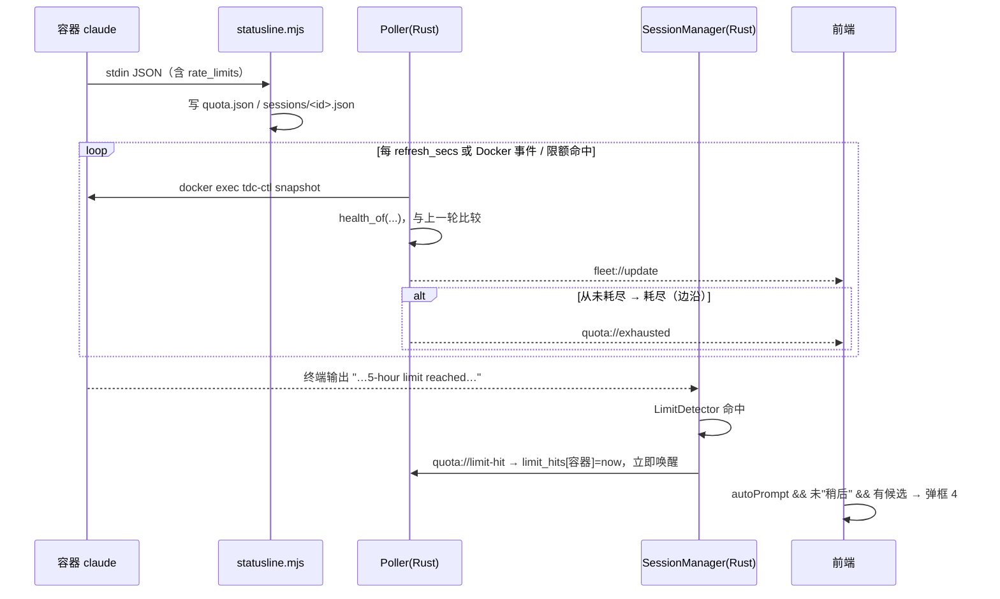
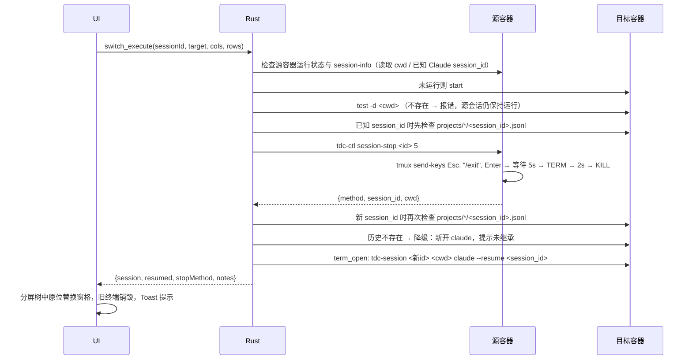

# 03 · 额度采集协议与热切换逻辑

> 交付物 4。实现：容器侧 `docker/rootfs/opt/tdc/{statusline.mjs,tdc-ctl.sh,tdc-lib.mjs}`，
> 桌面端 `src-tauri/src/quota/`、`src-tauri/src/commands/term_cmds.rs::switch_execute`，
> 命令行版 `docker/scripts/{tdc-quota.sh,tdc-switch.sh}`。

## 1. 数据来源与限制

Claude Code 每次刷新底栏时，把一段 JSON 通过 stdin 传给 `statusLine.command`。其中与额度相关的字段（已在本机 claude-hud 0.11.1 源码 `src/types.ts` / `src/stdin.ts` 中确认）：

```jsonc
{
  "session_id": "7d1f3c2a-…",              // --resume 用
  "cwd": "/workspace/app",
  "workspace": { "current_dir": "/workspace/app/src" },
  "model": { "id": "claude-opus-5-5", "display_name": "Opus 5.5" },
  "context_window": { "used_percentage": 12.3 },
  "rate_limits": {
    "five_hour": { "used_percentage": 15.25, "resets_at": 1792130400 },  // 0~100，epoch 秒
    "seven_day": { "used_percentage": 40,    "resets_at": 1792562400 }
  }
}
```

**限制（必须让用户知道）：**
1. 只有**百分比**，没有 token 绝对值。
2. 只在容器内 claude **运行并刷新 statusline** 时更新；空闲容器显示"上次已知值 + 新鲜度"，`resets_at` 已过则推断为已恢复（UI 以 `*` 标注）。
3. API 模式没有 `rate_limits`。
4. 字段属于 Claude Code 的 statusline 协议，未来版本可能变化；镜像锁定 Claude Code 版本（`CLAUDE_CODE_VERSION`）以降低风险。Phase 0 需在真实容器中验证该字段在订阅登录与 `CLAUDE_CODE_OAUTH_TOKEN` 两种模式下都存在。

## 2. 容器内状态文件（协议 1）

位于 `$TDC_STATE_DIR = /home/node/.claude/tdc/state`（home 卷内），均为原子写（tmp + rename）。

### quota.json（账号级，同容器所有会话共享）
```json
{
  "protocol": 1,
  "updated_at": 1792120000,
  "rate_limits_updated_at": 1792120000,
  "container": "claude-dev-01",
  "auth_hint": "subscription",
  "five_hour": { "used_percentage": 15.3, "resets_at": 1792130400 },
  "seven_day": { "used_percentage": 40, "resets_at": 1792562400 },
  "model": { "id": "claude-opus-5-5", "display_name": "Opus 5.5" },
  "claude_version": "2.1.300",
  "last_session": { "session_id": "7d1f…", "tdc_session_id": "a1b2c3d4", "cwd": "/workspace/app/src" }
}
```
合并规则：本次 stdin 缺少某窗口时**保留旧值**，`rate_limits_updated_at` 只在拿到新额度时更新。

### sessions/<tdc_session_id>.json（会话级）
```json
{ "protocol": 1, "updated_at": 1792120000, "tdc_session_id": "a1b2c3d4",
  "session_id": "7d1f…", "transcript_path": "…/7d1f….jsonl", "cwd": "/workspace/app/src",
  "model": {…}, "context_used_percentage": 12.3, "cost_usd": 0.42 }
```
`tdc_session_id` 由桌面端通过 `TDC_SESSION_ID` 环境变量注入，建立"桌面终端会话 ↔ Claude 会话"映射，这是热切换能 `--resume` 的关键。

### ports.json
```json
{ "protocol": 1, "updated_at": 1792120000,
  "ports": [ { "port": 3000, "binds": ["0.0.0.0","::"], "family": "dual", "loopback_only": false, "pid": 812, "process": "node" } ] }
```

### `tdc-ctl snapshot`（桌面端每轮一次 exec）
```json
{ "protocol": 1, "now": …, "meta": {…}, "quota": {…}, "ports": {…},
  "provider": { "mode": "subscription|api", "base_url": null, "model": null },
  "account": { "logged_in": true, "email": "…", "organization_type": "claude_max", "rate_limit_tier": "…" },
  "sessions": [ … ], "tmux": [ { "id": "a1b2c3d4", "created_at": …, "attached": 1, "cwd": "…", "command": "node" } ] }
```
`account` 只读取 `.claude.json` 的 `oauthAccount` 非敏感字段，**从不输出令牌**。

## 3. 健康度算法（`quota/switch.rs` ≡ `tdc-lib.mjs`）

```
effective_used(win) = (now ≥ win.resets_at) ? 0（推断）: win.used_percentage
remaining           = 100 − max(effective_used(5h), effective_used(7d))   // 两窗口都无数据 → 未知

health =
  stopped    若容器未运行
  api        若 provider.mode == api
  exhausted  若终端检测到限额文案 或 任一窗口 effective_used ≥ switch_threshold(默认 100)
  unknown    若 remaining 未知
  healthy    若 remaining > warn_threshold(30)
  warning    若 remaining ≥ critical_threshold(5)
  exhausted  否则
blocked_until = 所有达到阈值窗口中最晚的 resets_at
```

## 4. 候选排序

```
排除：源容器
tier 1  运行中 · 订阅 · 未耗尽 · 剩余已知且 > 0
tier 2  运行中 · 订阅 · 剩余未知
tier 3  已停止 · 订阅                     （仅 include_stopped）
tier 4  运行中 · API                      （仅 allow_api_fallback，会产生费用）
排序：tier ↑ → remaining ↓ → 5h resets_at ↑（早重置者优先）→ 名称
```
用例 `docker/tests/fixtures/ranking-cases.json` 同时被 Rust（`cargo test`）和 Node（`node --test`）测试，保证 CLI 与桌面端结论一致。

## 5. 触发



辅助信号（限额文案）在额度数据比命中时间新 60 秒以上时自动清除，避免误判常驻。

## 6. 热切换执行（`switch_execute`）



| 继承 | 不继承 |
|---|---|
| Claude 对话历史（共享 `tdc_shared_projects` + `--resume`） | shell 进程、环境变量（会话自定义 env 会复制） |
| 项目源码（同一宿主目录挂到相同路径） | 后台进程（dev server 需在目标容器重启） |
| 工作目录 | prompt cache：首轮按完整上下文计费，长对话会立即消耗目标账号较多额度 |

**未验证的前提（Phase 0 必须实测）**：账号 A 创建的会话 JSONL 能否被账号 B 的 claude `--resume`。若失败，降级为"在相同目录新开 claude + 提示用户"——代码已处理该分支。

## 7. 命令行版（无桌面端时）

```bash
cd docker
./scripts/tdc-quota.sh            # 表格：🟢/🟡/🔴/⚪/🔵 容器 模式 5h剩余@重置 周剩余@重置 模型
./scripts/tdc-quota.sh --json     # 带 health / remaining
docker exec claude-dev-01 tdc-ctl session-list     # 查会话 ID
./scripts/tdc-switch.sh claude-dev-01 a1b2c3d4     # 自动选目标并 --resume，直接附着终端
./scripts/tdc-switch.sh claude-dev-01 a1b2c3d4 claude-dev-02   # 指定目标
```
宿主机无需 Node/jq：计算在运行中的容器内执行 `node /opt/tdc/tdc-lib.mjs`。

## 8. 调试：模拟额度耗尽

真实撞限额难以复现。debug 构建提供 `debug_inject_quota`，可在 WebView DevTools 控制台执行：
```js
await window.__TAURI_INTERNALS__.invoke("debug_inject_quota", {
  container: "claude-dev-01",
  quota: { five_hour: { used_percentage: 100, resets_at: Math.floor(Date.now()/1000) + 3600 }, seven_day: null }
});
// 清除：quota: null
```
